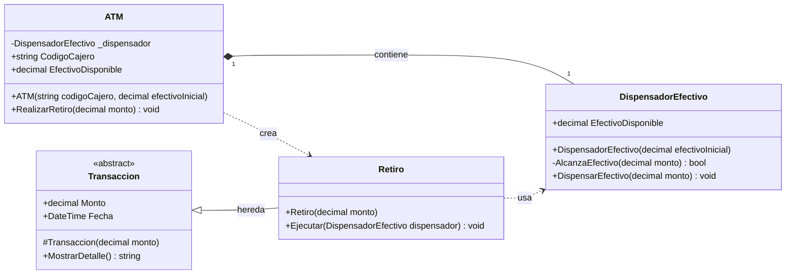
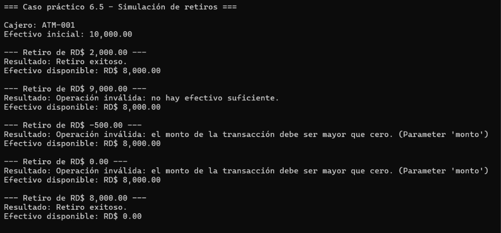

# Caso práctico 6.5 — Modelado del Sistema ATM II

Modelo simplificado del cajero automático de Deitel que demuestra **herencia** y **composición** en C#, como parte del **Programa FullStack .NET Cloud Developer** (Semana 6 — Programación Orientada a Objetos II).

## Objetivo

Analizar y representar relaciones de herencia y composición utilizando un modelo simplificado del sistema ATM, implementarlas en C# y simular un retiro de efectivo en consola.

## Clases del modelo

| Clase | Responsabilidad | Relación |
|---|---|---|
| `ATM` | Coordinar el flujo de interacción y las operaciones del cajero. | Compone un `DispensadorEfectivo`; crea y usa un `Retiro` |
| `Transaccion` | Representar los datos comunes a toda operación bancaria. Es abstracta. | Clase base de `Retiro` |
| `Retiro` | Ejecutar la entrega de efectivo usando el dispensador del cajero. | Hereda de `Transaccion`; usa el `DispensadorEfectivo` que recibe |
| `DispensadorEfectivo` | Representar la disponibilidad y entrega de efectivo. | Parte de `ATM` (composición, 1 a 1) |

El análisis completo —constructores, propiedades, métodos y cambios respecto al caso 5.5— está en [`docs/analisis.md`](docs/analisis.md).

## Relaciones implementadas

### Herencia: `Retiro` → `Transaccion`
Un retiro **es una** transacción: tiene los mismos datos que cualquier transacción (monto y fecha) y agrega su propio comportamiento, entregar efectivo. `Retiro` hereda `Monto` y `Fecha` sin volver a declararlos, y su constructor delega su inicialización en `Transaccion` mediante `base(monto)`. `Transaccion` es abstracta, porque no existe una transacción "genérica" en el dominio bancario.

### Composición: `ATM` ◆ `DispensadorEfectivo`
Un cajero **tiene un** dispensador que forma parte de él: se crea junto con el ATM, no se comparte con otros cajeros y no existe fuera de él. El `ATM` crea su dispensador dentro de su constructor y lo guarda en un campo `private readonly`; hacia afuera solo expone el efectivo disponible, no el objeto, de modo que toda entrega de efectivo pasa por las reglas del cajero.

### Uso: `Retiro` → `DispensadorEfectivo`
El retiro no es dueño del dispensador: lo recibe del `ATM` solo durante la ejecución de la operación.

La justificación detallada de cada relación está en [`docs/analisis.md`](docs/analisis.md#2-justificación-de-las-relaciones).

## Diagrama de clases



| Notación | Significado |
|---|---|
| Triángulo hueco (`Retiro` → `Transaccion`) | Herencia |
| Rombo relleno del lado de `ATM` | Composición, con multiplicidad 1 a 1 |
| Línea punteada con flecha | Dependencia: `ATM` crea un `Retiro`; `Retiro` usa el dispensador que recibe |
| `+` / `-` / `#` | `public` / `private` / `protected` |
| `«abstract»` | Clase abstracta |

También disponible como imagen en [`docs/diagrama.png`](docs/diagrama.png).

## Requerimientos técnicos

| Requerimiento | Cómo se cumple |
|---|---|
| Clases y objetos | Cuatro clases en `Modelos/`, instanciadas desde `Program.cs` |
| Herencia | `Retiro : Transaccion`, con `base(monto)` en el constructor |
| Composición | `ATM` crea y contiene su `DispensadorEfectivo` |
| Constructores | Todas las clases reciben sus datos por constructor y los validan |
| Encapsulamiento básico | Propiedades con `private set` o de solo lectura, campo `private readonly` para el dispensador, método `AlcanzaEfectivo` privado y constructor `protected` en la clase abstracta |

## Validaciones

| Clase | Regla | Excepción |
|---|---|---|
| `ATM` | El código del cajero es obligatorio | `ArgumentException` |
| `DispensadorEfectivo` | El efectivo inicial no puede ser negativo | `ArgumentOutOfRangeException` |
| `DispensadorEfectivo` | El monto a dispensar debe ser mayor que cero | `ArgumentOutOfRangeException` |
| `DispensadorEfectivo` | Debe haber efectivo suficiente | `InvalidOperationException` |
| `Transaccion` | El monto debe ser mayor que cero | `ArgumentOutOfRangeException` |

## Documentación del código

Las clases públicas del modelo, sus constructores, propiedades y métodos están documentados con **comentarios XML** (`///`). Visual Studio los muestra en IntelliSense al usar cada miembro, e indican sus restricciones (por ejemplo, que el monto debe ser mayor que cero) y las excepciones que puede lanzar. Los comentarios de línea (`//`) se reservan para explicar decisiones de diseño que no se deducen del código, como por qué el `ATM` expone el efectivo disponible y no el dispensador.

## Estructura del proyecto

```
├── Modelos/
│   ├── ATM.cs
│   ├── DispensadorEfectivo.cs
│   ├── Transaccion.cs
│   └── Retiro.cs
├── docs/
│   ├── analisis.md                # Análisis de clases y justificación de relaciones
│   ├── diagrama.png               # Diagrama de clases
│   └── evidencias/
│       └── ejecucion.png          # Captura de la ejecución
├── Program.cs                     # Simulación de retiros en consola
├── CP65_ModeladoDelSistemaATMII.csproj
└── CP65_ModeladoDelSistemaATMII.slnx
```

## Cómo ejecutar

Requisito: [.NET SDK 10](https://dotnet.microsoft.com/download).

```bash
git clone https://github.com/DHDanaurysHiraldo/6.5-CP_ModeladoDelSistemaATMII.git
cd 6.5-CP_ModeladoDelSistemaATMII
dotnet run
```

## Ejecución

`Program.cs` crea un cajero `ATM-001` con RD$10,000.00 y simula cinco retiros consecutivos. Cada intento se procesa dentro de un bloque `try/catch/finally`: los `catch` atrapan por separado las excepciones de monto inválido (`ArgumentOutOfRangeException`) y de efectivo insuficiente (`InvalidOperationException`), y el `finally` muestra el efectivo disponible después de cada intento, haya sido exitoso o no.

| Retiro | Resultado | Efectivo después | Qué demuestra |
|---|---|---|---|
| RD$2,000.00 | Retiro exitoso | RD$8,000.00 | Herencia, composición y uso trabajando juntas |
| RD$9,000.00 | Rechazado: no hay efectivo suficiente | RD$8,000.00 | Validación del dispensador; el efectivo no cambia |
| RD$-500.00 | Rechazado: monto inválido | RD$8,000.00 | Validación heredada de `Transaccion` |
| RD$0.00 | Rechazado: monto inválido | RD$8,000.00 | El cero también se rechaza (`<= 0`) |
| RD$8,000.00 | Retiro exitoso | RD$0.00 | Valor límite: se puede retirar todo el efectivo disponible |

Ningún retiro rechazado modifica el efectivo: todas las validaciones ocurren antes de descontarlo.



> El texto `(Parameter 'monto')` en los rechazos por monto inválido lo agrega .NET automáticamente al mensaje de `ArgumentOutOfRangeException`, e identifica el parámetro que no cumplió la regla.

## Alcance

**Incluye:** las clases `ATM`, `Transaccion`, `Retiro` y `DispensadorEfectivo`; una relación de herencia, una de composición y la simulación de un retiro en consola.

**No incluye:** cuentas de cliente ni validación de saldo, autenticación, otras transacciones (depósito, consulta), interfaz de usuario ni persistencia.

## Antecedente

Este proyecto continúa el caso práctico 5.5 ([Modelado del Sistema ATM](https://github.com/DHDanaurysHiraldo/5.5CP_ModeladoDelSistemaATM)). La clase `Transaccion` parte de esa versión y se transforma en clase base abstracta; `ATM` y `DispensadorEfectivo`, que en el 5.5 solo figuraban en el análisis, se implementan aquí.

## Autor

**DHDanaurysHiraldo** — [GitHub](https://github.com/DHDanaurysHiraldo)
